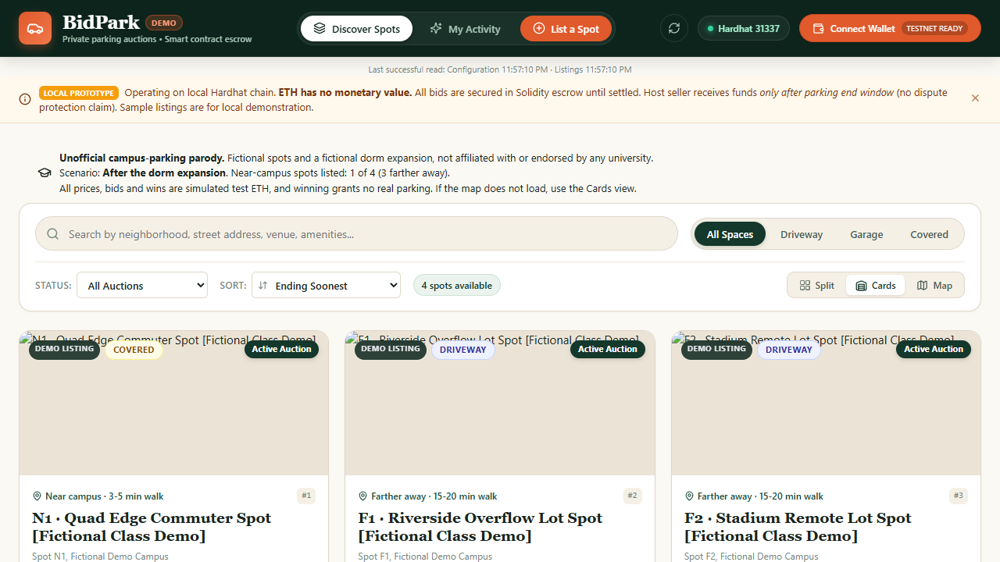
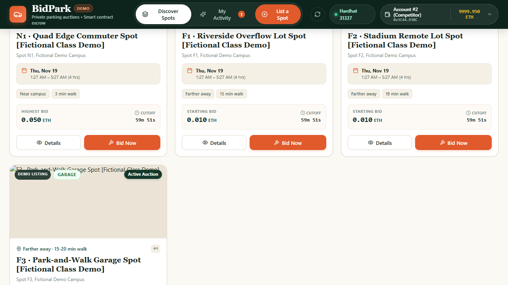
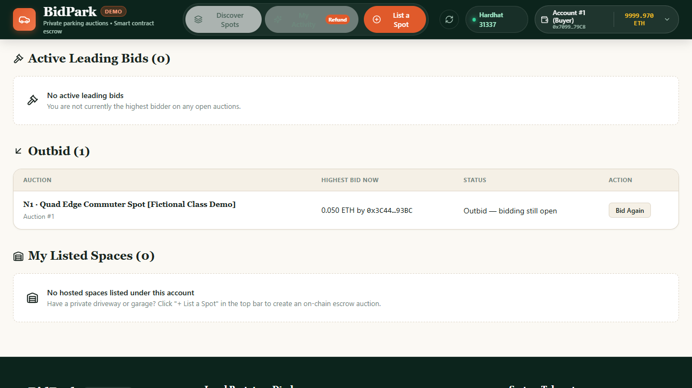
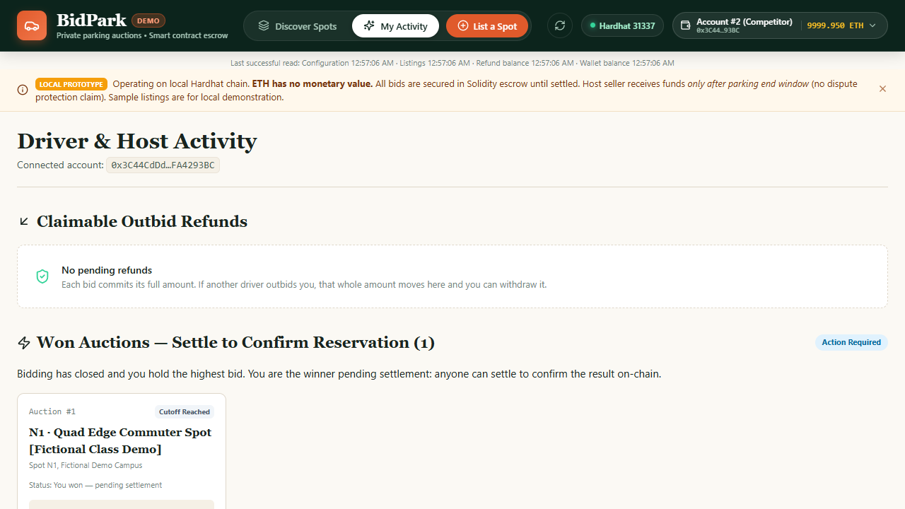
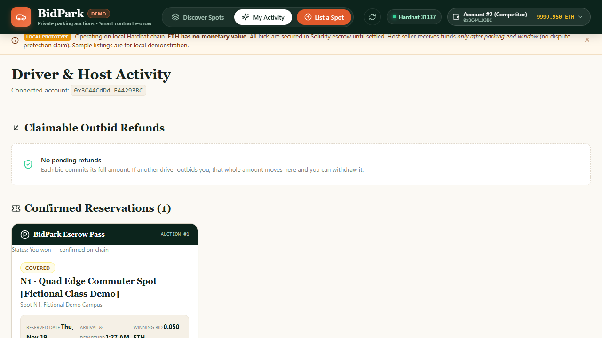

# Class demo presenter script

About five minutes. Everything runs on one laptop with no wallet extension and no internet after `npm ci`. Setup, accounts and the reset are in [class demo scenarios](class-demo-scenarios.md).

## Before class

1. `npm ci` once.
2. Rehearse once with each scenario, using the steps below.
3. Keep this page and the screenshots in [`presenter/`](presenter/) open as the fallback.

## Run order

### 1. The premise (baseline), about 45 s

Start `BIDPARK_SCENARIO=campus-baseline npm run dev` and open http://127.0.0.1:5173. Click **Cards**.

Say: "This is a made-up campus, not any real university. Commuters bid for parking spots. Four spots are a short walk from class and three are a long way out."

On screen: the banner reads *Near-campus spots listed: 4 of 7 (3 farther away)*.


### 2. The dorm expansion, about 45 s

Stop the server (Ctrl+C) and start `BIDPARK_SCENARIO=campus-expansion npm run dev`. Click **Cards**.

Say: "Now a new dorm goes up on three of the good spots. Same commuters, same opening bids, one planned change."

On screen: *Near-campus spots listed: 1 of 4 (3 farther away)*. Only N1 is near campus.



Optional: run `npm run demo -- compare` to show the same counts read straight from the fixtures.

### 3. Two drivers want the last good spot, about 1 min

1. **Connect Wallet**, then **Account #1**. On N1, **Bid Now**, enter `0.03`, **Deposit 0.03 ETH**.
2. Switch to **Account #2** and bid `0.05` on N1.

Say: "Each bid sends the whole amount into the contract. Driver B just outbid driver A."

On screen: N1 shows a highest bid of 0.050 ETH.



### 4. The refund, about 45 s

Switch back to **Account #1** and open **My Activity**.

Say: "Driver A didn't lose their money. Their 0.03 is set aside as a refund they can pull out."

On screen: under **Outbid**, N1 reads *Outbid — bidding still open*, and the refund card offers **Withdraw 0.030 ETH**. Click it, and the card changes to *No pending refunds*.



### 5. Close bidding and settle, about 1 min

In a second terminal run `npm run demo -- advance`, then press **Refresh data** (the circular arrow) in the app.

Switch to **Account #2**. **My Activity** shows *Status: You won — pending settlement*.



Click **Settle Auction & Claim Pass**. It changes to *Status: You won — confirmed on-chain*, with the note that this is a simulated record that grants no real parking.



### 6. The punchline, about 30 s

Say: "Same commuters, fewer good spots: now three of them get pushed farther away, and whoever wants the last close spot has to outbid everyone else for it."

Optional: after a restart, `npm run demo -- commuters` plays this out with four commuters. In the expansion, one wins N1 and three fall back to farther spots. The baseline gives every commuter a near spot.

## What this shows, and what it doesn't

It shows:
- How an escrow auction works: each bid locks the full amount, an outbid amount becomes a withdrawable refund, and the winner is fixed once someone settles after the deadline.
- That with fewer near spots, the same people can't all get one. Some compete for what's left and the rest take the fallback.

It does not show:
- Anything about a real campus, its parking or its plans. All spots, counts, walking times and the dorm are fictional.
- What prices would actually be. The 0.03 / 0.05 bids, and the 0.06 in `commuters`, are numbers we picked for the script. Scarcity doesn't set them.
- A real reservation. The "pass" is a record on a local test chain with no monetary value, and it grants no parking access.

## Fallback

- **App won't start:** walk through the screenshots above in order. They were captured from the working app with `tests/e2e/presenter-*.spec.mjs`. Map tiles and photos were blocked, which is why the cards have no pictures.
- **Clicks go wrong live:** restart `npm run dev` with the expansion scenario, run `npm run demo -- walkthrough`, and refresh. It does steps 3 to 5 in one go: driver B wins N1 at 0.05 and driver A's 0.03 is withdrawn.
- **Map is blank:** use **Cards**. Nothing in the script needs the map.

## Refreshing the screenshots

With Google Chrome installed (no Playwright browser download needed):

```powershell
$env:BIDPARK_E2E_CHANNEL='chrome'; $env:BIDPARK_CAPTURE_DIR='docs/presenter'; npx playwright test presenter
```

CI runs the same two specs on every pull request without saving screenshots, so the scripted path stays working.
